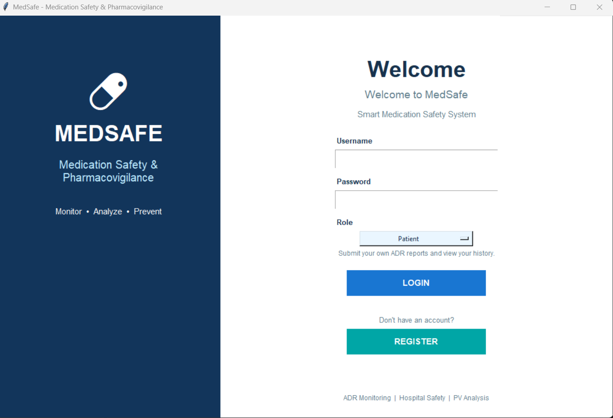

# MedSafe – Medication Safety & ADR Reporting System

## Project Overview
MedSafe is a medication safety and adverse drug reaction (ADR) reporting system developed using Python and Power BI. The project focuses on analyzing medication safety data and visualizing adverse drug reaction patterns to support pharmacovigilance analysis.

## Tools & Technologies
- Python
- Tkinter
- Pandas
- Matplotlib
- Power BI
- CSV

## Key Features
- Login and registration interface
- Medication safety data handling
- Hospital analysis and pharmacovigilance (PV) analysis
- ADR data visualization using Python
- Graphical analysis of medication safety data
- Power BI dashboard for medication safety analysis

## Project Files
- `medsafe.py` – Python application
- `Medication_Safety_Dataset.csv` – Dataset used for analysis
- `medsafe.pbix` – Power BI dashboard
- `README.md` – Project documentation

## How to Run
1. Install Python.
2. Install the required Python libraries, including Pandas and Matplotlib.
3. Ensure `Medication_Safety_Dataset.csv` is available in the location expected by the application.
4. Open a terminal in the project folder and run:

```bash
python medsafe.py
```

Additional dependencies may be required depending on your Python environment.

## Project Objective
To demonstrate the use of Python-based data handling and visualization, along with Power BI dashboard development, for medication safety and pharmacovigilance analysis.

## Disclaimer
This project is developed for educational and portfolio purposes. It is not intended for clinical decision-making.

## Screenshots

### 1. Login


### 2. Main Page


### 3. Hospital Analysis – Matplotlib Visualizations


### 4. PV Analysis – Matplotlib Visualizations


### 5. MedSafe Dashboard – Power BI

